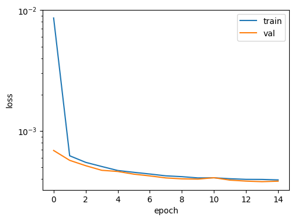
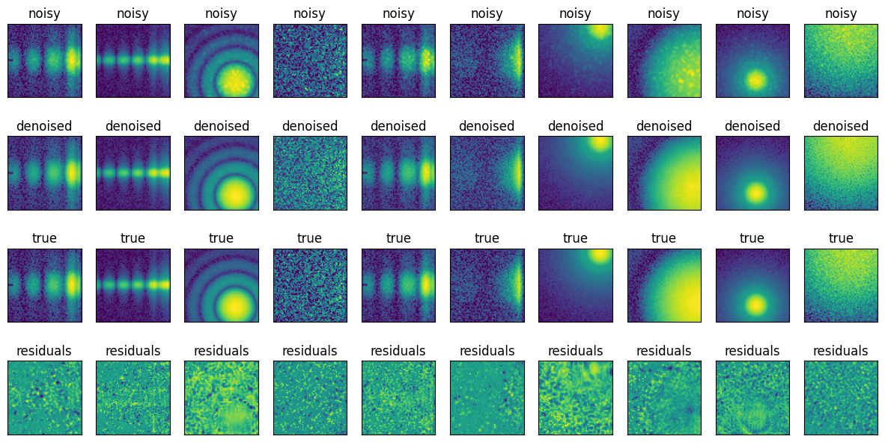

# Speckle Denoising with a PyTorch Autoencoder

A **PyTorch adaptation of a denoising autoencoder (DAE)** for removing speckle patterns from scattering images, prepared for the *Hauptseminar: Deep Learning* at Leipzig University (summer semester 2024).

**Provenance:** This is **not an independently developed solution** to the textbook exercise. The implementation uses the authors' **published TensorFlow/Keras solution to Exercise 17.1** from *Deep Learning for Physics Research* as a reference and translates the approach into PyTorch for a seminar presentation.

## Academic context and aims

- **Seminar:** Hauptseminar: Deep Learning, Leipzig University, summer semester 2024
- **Instructor:** Prof. Dr. Bernd Rosenow
- **Supervisor:** Marcel Kühn
- **Presenter / PyTorch adaptation:** Yoon Thelge
- **Seminar materials:** [Course website](https://home.uni-leipzig.de/stp/Hauptseminar_ss24.html) · [Presentation slides](https://home.uni-leipzig.de/stp/hauptseminar_ss24/Autoencoders_YoonThelge-2.pdf)

The presentation aimed to:

1. Introduce autoencoders, their encoder–decoder architecture, and denoising autoencoders.
2. Implement a convolutional DAE **in PyTorch**, with the published TensorFlow/Keras solution serving as the reference.
3. Explain practical differences between TensorFlow/Keras and PyTorch encountered during the adaptation.

The seminar website provides the presentation and associated course materials. A separate direct link to the written report has not been verified here.

## Implementation

The network learns to reconstruct clean scattering images from speckled inputs. The notebook includes:

- A convolutional encoder–decoder with max-pooling, upsampling, ReLU activations, and additive skip connections.
- Paired noisy/clean scattering images from the original exercise dataset (`speckles.npz`), transformed with `log10(image + 1)` and normalized.
- PyTorch tensors in **channels-first** format `(N, C, H, W)`, `TensorDataset`, and `DataLoader`.
- An explicit training loop with **Adam**, **mean squared error (MSE)**, batch size **128**, and **15 epochs**.
- A split of **20,000 training samples** and the remaining samples for validation and visual inspection. The latter partition is called `test` in parts of the code, but it is also used for validation; **it is not an independent held-out test set**.
- Visualization of the computation graph, loss history, and denoised reconstructions.

### TensorFlow/Keras and PyTorch comparison

| Aspect | TensorFlow/Keras reference | PyTorch adaptation |
| --- | --- | --- |
| Network definition | Keras layers/model API | `torch.nn.Module` and `forward()` |
| Image dimensions | Often channels-last `(N, H, W, C)` | Channels-first `(N, C, H, W)` |
| Optimization | `compile()` and `fit()` | Explicit loop, `loss.backward()`, `optimizer.step()` |
| Data loading | Keras/TensorFlow data handling | `TensorDataset` and `DataLoader` |
| Inference | `predict()` | `model.eval()` and `torch.no_grad()` |

This project is a framework-adaptation and teaching exercise, **not a controlled TensorFlow-versus-PyTorch speed benchmark**.

## Installation and execution

Use a compatible Python 3 environment (the saved Colab execution used Python 3.10). From the repository root:

```bash
python3 -m venv .venv
source .venv/bin/activate
python -m pip install --upgrade pip
python -m pip install -r requirements.txt
jupyter notebook speckle_denoising_pytorch.ipynb
```

The supplied **`requirements.txt`** lists NumPy, SciPy, contourpy, Matplotlib, scikit-learn, PyTorch, torchvision, torchsummary, torchviz, gdown, Jupyter, and ipykernel. There is no need to install these packages separately if the requirements installation succeeds. 

The notebook also includes a !pip install torchviz cell to facilitate execution in Google Colab, where the dependencies may not have been installed from requirements.txt. This cell can be skipped when running the notebook locally after installing the requirements.

**Optional network-graph rendering:** `torchviz` uses the **Graphviz system executable** (`dot`) when rendering the model diagram. It is not supplied by `pip install -r requirements.txt`. On macOS with Homebrew:

```bash
brew install graphviz
```

On Ubuntu/Debian: `sudo apt install graphviz`. Check installation with `dot -V`. Graphviz is needed for the visualization cell, **not for DAE training**.

**Hardware:** The notebook uses CUDA acceleration when available and otherwise falls back to CPU. GPU acceleration is recommended for training, as CPU execution may be considerably slower.

The notebook can be executed locally or in Google Colab. For computationally intensive training, a GPU-enabled Google Colab runtime is recommended.

### Dataset and generated files

The notebook attempts to download `speckles.npz` with `gdown` into `data/` if the file is absent. It creates `data/` and `figures/` relative to the **current working directory**; run it from the repository root. Dataset access depends on the original hosted file remaining available.

The dataset (~232 MB), pretrained model weights, and temporary training files are **not distributed** with this repository. If you just want to inspect the recorded outputs, **open the notebook without running its cells**.

## Recorded results

The uploaded notebook contains outputs from a **15-epoch Google Colab training run**. The final printed metrics were:

| Metric | Recorded value (epoch 15) |
| --- | ---: |
| Training MSE | `0.000381` |
| Validation MSE | `0.000377` |

These are results from the saved execution, **not claims of a fresh run or an independent test evaluation**. Training is stochastic; exact results may differ upon rerunning. Some source cells were edited after the saved Colab execution, so output labels and old paths may not exactly match the current cell source.

The PNGs below were extracted from **existing notebook outputs without retraining**:

**Training and validation loss**



**Example reconstructions**



Additional saved images: [example input/target images](figures/example_data.png) and [autoencoder computation graph](figures/autoencoder_graph.png).

## Repository contents

```text
.
├── README.md
├── requirements.txt
├── .gitignore
├── speckle_denoising_pytorch.ipynb
└── figures/
    ├── example_data.png
    ├── autoencoder_graph.png
    ├── training_validation_loss.png
    └── denoising_reconstructions.png
```

The figures above are **PNG copies of embedded notebook outputs**; they are not the separate PDF files that some current notebook cells are configured to generate during execution. If a full training run is performed, the notebook may also create PDF figures inside `figures/`.

## Original source, attribution, and licensing

**Textbook:** Martin Erdmann, Jonas Glombitza, Gregor Kasieczka, and Uwe Klemradt, *Deep Learning for Physics Research*, World Scientific (2021), Chapter 17, Exercise 17.1, DOI: [10.1142/12294](https://doi.org/10.1142/12294).

**Reference materials:**

- [Official textbook companion repository](https://github.com/DeepLearningForPhysicsResearchBook/deep-learning-physics)
- [Exercise 17.1](https://github.com/DeepLearningForPhysicsResearchBook/deep-learning-physics/blob/main/Exercise_17_1.ipynb)
- [Authors' TensorFlow/Keras solution to Exercise 17.1](https://github.com/DeepLearningForPhysicsResearchBook/deep-learning-physics/blob/main/Exercise_17_1_solution.ipynb)
- [Upstream license and attribution](https://github.com/DeepLearningForPhysicsResearchBook/deep-learning-physics/blob/main/LICENSE.md)

**Adaptation notice:** The network design and exercise approach were adapted from the original TensorFlow/Keras solution into PyTorch for the seminar. Credit for the original exercise and reference solution belongs to the book's authors. The notebook is **not an official solution released by those authors**, and no endorsement is implied.

**Licensing:** The original **companion repository** is distributed under [Creative Commons Attribution–NonCommercial 4.0 International (CC BY-NC 4.0)](https://creativecommons.org/licenses/by-nc/4.0/). Adapted material originating from that repository must retain appropriate credit, links to the source and license, identification of changes, and the noncommercial-use restriction. The upstream CC BY-NC license does **not** by itself establish a license for the separately published book or the externally hosted dataset; those materials are not redistributed here. The author of this PyTorch adaptation should explicitly choose licensing terms for any independently authored contributions; no additional license for those contributions is asserted by this README.

When citing this project, please cite the book **and** describe this repository as a seminar PyTorch adaptation of its published Exercise 17.1 TensorFlow solution.
